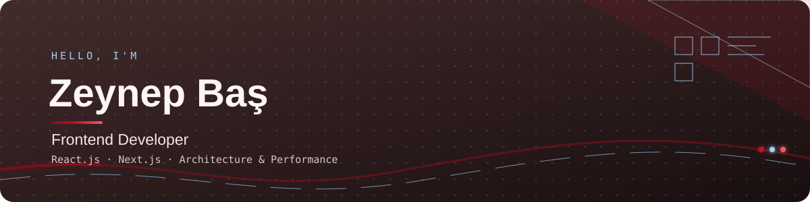

  

<h1 align="center">Zeynep Baş</h1>

  <b>Frontend Developer</b> · React · Next.js · TypeScript 
  Mimari ve performans odaklı, ölçeklenebilir ve sürdürülebilir arayüzler geliştiriyorum.

  
  
  

---

## Hakkımda

Frontend geliştirmede önceliğim yalnızca hızlı teslim etmek değil, doğru mimari kararı vermek. Component sınırlarını, state'in nerede yaşayacağını ve hangi katmanlara gerçekten ihtiyaç olduğunu; çözülen probleme ve uygulamanın gerçek ihtiyacına göre belirliyorum.

Gereksiz soyutlamadan kaçınan, okunabilir, test edilebilir ve ekip içinde kolayca sahiplenilebilen kod tabanları kurmayı hedefliyorum.

## Yaklaşımım

- **Bağlama göre mimari** — Atomic Design, Repository, Strategy ve Dependency Injection gibi desenleri ihtiyaç olduğunda, ölçülü şekilde uygularım.
- **Bileşen tasarımı** — Kompozisyon odaklı, tek sorumluluğa sahip ve yeniden kullanılabilir bileşenler.
- **State yönetimi** — State'i kullanıldığı yere en yakın konumda tutar, global store'u yalnızca gerçekten gerektiğinde kullanırım.
- **Performans** — Code splitting, lazy loading, memoization ve React Server Components ile ölçülebilir iyileştirmeler.
- **Erişilebilirlik ve SEO** — Semantik HTML, klavye ile kullanılabilirlik ve arama motoru uyumu varsayılan standarttır.

## Teknolojiler

| Alan | Araçlar |
| :--- | :--- |
| Dil | TypeScript, JavaScript (ES2023+), HTML5, CSS3 |
| Framework | React, Next.js (App Router, RSC), React Native, Expo |
| Stil | Tailwind CSS, CSS Modules, Material UI |
| State ve Veri | Zustand, Context API, Axios, Formik, Yup |
| Gerçek Zamanlı ve Backend Entegrasyonu | REST API, Socket.IO, JWT, NextAuth, Firebase, Redis |
| Araçlar | Git, GitHub, Docker, npm |

## Öne Çıkan Projeler

Feature based mimari, ölçeklenebilir state yönetimi ve gerçek zamanlı etkileşim üzerine geliştirdiğim projeler. Tamamı için: [zeynepbas.dev/projeler](https://www.zeynepbas.dev/projeler)

| Proje | Açıklama | Öne Çıkanlar | Teknolojiler |
| :--- | :--- | :--- | :--- |
| [**PDOS**](https://github.com/zeynepbass/personal-data-operating-system) | Görev, not, hedef, doküman ve günlük aktiviteleri tek çalışma alanında toplayan kişisel verimlilik sistemi. | Görev yönetimi · Not ve doküman yönetimi · Hedef takibi · Aktivite geçmişi | Next.js · Repository Pattern · DI · Docker |
| [**MILK**](https://github.com/zeynepbass/milk) | Yerel üreticileri tüketicilerle doğrudan buluşturan, aracısız pazar platformu. | Gerçek zamanlı mesajlaşma · Ürün listeleme · Sosyal etkileşim | React · Socket.IO · Redis · JWT · Docker |
| [**Workist**](https://github.com/zeynepbass/workist) | Freelance hizmet ilanı oluşturma, yönetme ve değerlendirme süreçlerini uçtan uca kapsayan platform. | İlan yönetimi · Kullanıcılar arası sohbet · Hizmet değerlendirme | React · Socket.IO · Atomic Design · DI |
| [**Hizmet Kap**](https://github.com/zeynepbass/service-port) | Hizmet ilanı oluşturma, yönetme ve sağlayıcıları değerlendirme süreçlerini tek akışta birleştiren web uygulaması. | İlan oluşturma · İlan yönetimi · Değerlendirme sistemi | React · Material UI · Socket.IO · Leaflet |
| [**Salonify**](https://github.com/zeynepbass/salonify) | Kuaför ve güzellik salonlarını puan, portföy ve gerçek boş saatlere göre karşılaştırıp anında randevu alınabilen platform. | Anında randevu · Salon arama ve filtreleme · Yönetim paneli · Takvim ve bildirimler | Next.js · React · Axios |

## Açık Kaynak

- [**usecraft**](https://github.com/zeynepbass/usecraft) — Değerleri debounce etmek için sade API'ye sahip, npm üzerinde yayımlanan React hook'u.
- [**motion-kit**](https://github.com/zeynepbass/motion-kit) — Modern arayüzler için hafif, yalnızca CSS tabanlı animasyon araç seti.

## İletişim

Yeni projeler, iş birlikleri ve frontend mimarisi üzerine konuşmalara her zaman açığım.
[zeynepbas.dev](https://www.zeynepbas.dev) · [LinkedIn](https://www.linkedin.com/in/zeynepbasss)

  

