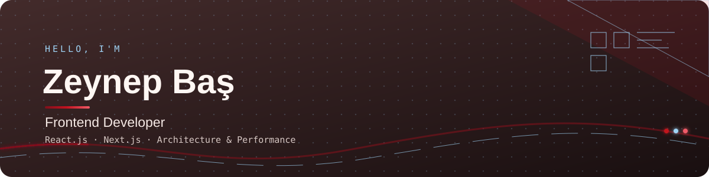

  

  

## Hakkımda

Frontend geliştirmede önceliğim sadece hız değil, doğru mimari kararı vermek.
Component sınırlarını, state'in konumunu ve gerekli katmanları; çözdükleri
probleme ve uygulamanın gerçek ihtiyacına göre belirliyorum.

  

## Yetenekler

  

  

